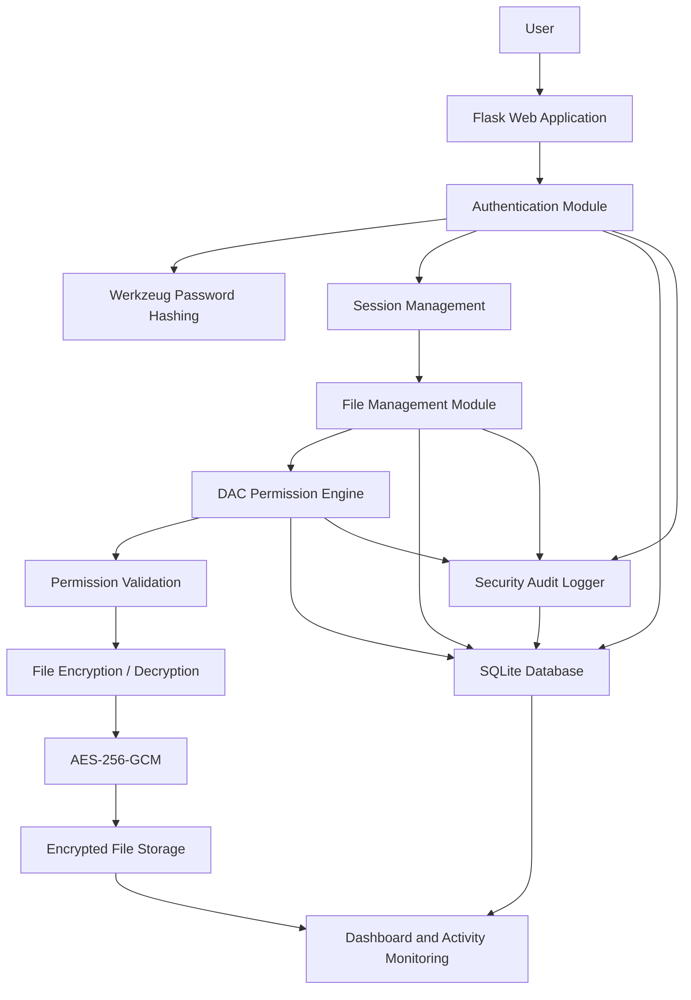
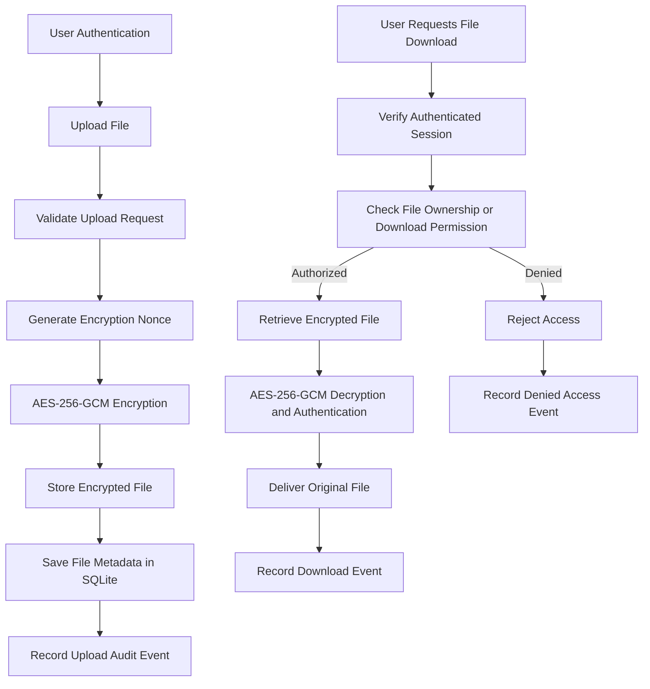
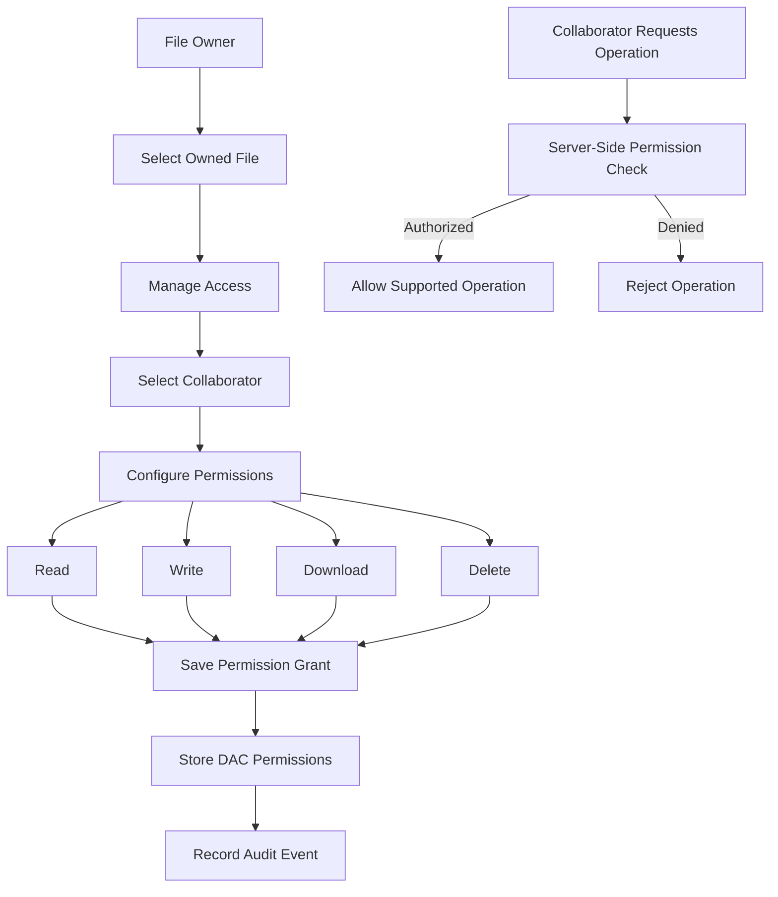

# SecureShare — Discretionary Access Control & Encrypted File Sharing

A secure file management and sharing platform built with Python and Flask, demonstrating **Discretionary Access Control (DAC), AES-256-GCM authenticated encryption, password hashing, and security audit logging**.

SecureShare enables users to upload encrypted files, manage individual access permissions, share documents with other registered users, and monitor security-related activities through an interactive dashboard.

<p align="center">

  **Cybersecurity · Access Control · Cryptography · Secure File Management**

</p>

---

## Project Overview

File-sharing platforms must balance accessibility with confidentiality and controlled access. Unrestricted sharing, weak permission management, and inadequate security monitoring can expose sensitive information to unauthorized users.

SecureShare addresses these concerns through an owner-managed file-sharing model based on Discretionary Access Control.

Each file owner can grant, update, and revoke permissions for individual users. Uploaded file contents are encrypted using AES-256-GCM before being stored on disk, while account passwords are protected using Werkzeug password hashing.

The application also maintains an audit trail of important security events, providing visibility into file access, permission changes, authentication attempts, and denied operations.

> **Internship connection:** This project extends the topic stated in my Sri Tech Software Services internship certificate: *Discretionary Access Control (DAC) with Network Security and Cryptography*. It is an independent portfolio implementation and does not claim that this exact application was developed during the internship.

---

## Key Features

### 1. User Authentication and Account Security
- User registration and login.
- Secure password hashing using Werkzeug.
- Authentication-based access to application features.
- Successful and failed login event logging.

### 2. Discretionary Access Control (DAC)
- File owners control access to their documents.
- Grant permissions to individual registered users.
- Update existing permission grants.
- Revoke previously granted permissions.
- Enforce permission checks on protected server-side operations.

### 3. AES-256-GCM File Encryption
- Encrypt file contents before writing them to disk.
- Use authenticated encryption to protect confidentiality and integrity.
- Decrypt files only after the relevant download permission check succeeds.
- Keep encryption keys separate from the source repository.

### 4. Granular File Permissions

SecureShare supports four individual permission types:

- Read
- Write
- Download
- Delete

The permission model distinguishes between implemented operations and permissions recorded for future functionality.

### 5. Security Audit Trail
Records security-relevant events, including:

- Account creation.
- Successful and failed authentication.
- File uploads and downloads.
- File deletion.
- Permission grants, updates, and revocations.
- Unauthorized or denied access attempts.

### 6. Interactive Security Dashboard
- View owned files.
- Access files shared by other users.
- Manage collaborator permissions.
- Review recent security activity.
- Monitor file-sharing operations through a centralized interface.

### 7. Secure File Storage
- SQLite for application metadata and account information.
- Encrypted file blobs stored separately from database records.
- Local development data excluded from Git tracking.

---

## System Architecture

SecureShare follows a modular security architecture that separates authentication, access-control enforcement, encryption, file storage, and audit logging.

### 1. Overall System Architecture



### 2. Core Security Components

| Component | Technology / Mechanism | Responsibility |
|---|---|---|
| Web application | Flask | Handles HTTP requests and application routing |
| Authentication | Werkzeug | Password hashing and verification |
| Session management | Flask sessions | Maintains authenticated user sessions |
| Access control | Discretionary Access Control | Manages owner-controlled file permissions |
| Encryption | AES-256-GCM | Encrypts and authenticates file contents |
| Metadata storage | SQLite | Stores user, file, permission, and audit information |
| File storage | Local filesystem | Stores encrypted file contents |
| Audit logging | Application-level event logging | Records security-related application activities |
| User interface | HTML and CSS | Provides file management and permission interfaces |

### 3. Secure File Upload and Download Workflow



### 4. DAC Permission Management Workflow



---

## Discretionary Access Control (DAC)

Discretionary Access Control allows the owner of a resource to determine which individual users can access that resource and what operations they are permitted to perform.

In SecureShare, each uploaded file has an owner who can manage permissions for other registered users.

### Permission Matrix

| Permission | Purpose | Implementation Status |
|---|---|---|
| Read | Grants access to the shared file's permission context | Supported by the DAC model |
| Write | Represents permission to modify a file | Recorded grant; editor not implemented |
| Download | Authorizes file decryption and delivery | Implemented with server-side checks |
| Delete | Authorizes deletion of a shared file | Implemented with server-side checks |
| Owner control | Allows the owner to manage their file | Full owner control |

**Important implementation detail:** The `write` permission is stored as a DAC grant for future in-app editing functionality. SecureShare does not currently provide a file editor. The permission should therefore not be interpreted as an implemented file-modification capability.

The file owner always retains full control over their own files.

---

## Cryptographic Security

### AES-256-GCM Encryption

SecureShare uses AES-256-GCM (Advanced Encryption Standard with a 256-bit key in Galois/Counter Mode) to protect uploaded file contents.

AES-GCM provides:

- Confidentiality through encryption.
- Integrity verification through an authentication tag.
- Protection against undetected modification of encrypted content.

**Encryption workflow:**

1. Receive the uploaded file.
2. Generate a unique nonce for the encryption operation.
3. Encrypt the file contents using AES-256-GCM.
4. Store the encrypted output.
5. Retain the encryption key outside the repository.

**Decryption workflow:**

1. Authenticate the requesting user.
2. Verify file ownership or the required download permission.
3. Retrieve the encrypted file.
4. Decrypt and authenticate the encrypted content.
5. Deliver the original file only after successful verification.

### Password Security

User passwords are not stored as plaintext. Werkzeug password hashing is used to securely hash passwords during registration and verify them during authentication.

### Encryption Key Management

The application supports an environment-based encryption key configuration.

Generate a URL-safe Base64-encoded key containing 32 random bytes:

```bash
python -c "import base64,secrets; print(base64.urlsafe_b64encode(secrets.token_bytes(32)).decode())"
```

Store the generated value in the `FILE_ENCRYPTION_KEY` environment variable.

**Critical:** Losing the encryption key makes the corresponding encrypted files unrecoverable. Back up the key securely and never commit it to GitHub.

---

## Security Audit and Monitoring

SecureShare records security-relevant events to help users understand important activities occurring within the application.

| Event | Purpose |
|---|---|
| Account creation | Records new account registration |
| Successful login | Records successful authentication |
| Failed login | Identifies unsuccessful authentication attempts |
| File upload | Records document upload activity |
| File download | Records authorized download activity |
| File deletion | Records file removal activity |
| Permission changes | Tracks DAC grant modifications |
| Denied access | Records rejected access attempts |

The audit trail provides application-level visibility into security operations.

**Limitation:** Audit events are stored in the same SQLite database as application metadata. They are not tamper-proof or equivalent to an independently protected security information and event management system.

---

## Technology Stack

| Category | Technologies |
|---|---|
| Programming Language | Python 3.10+ |
| Backend Framework | Flask |
| Database | SQLite |
| Cryptography | AES-256-GCM |
| Cryptographic Library | Python Cryptography |
| Password Security | Werkzeug |
| Frontend | HTML, CSS |
| Application Security | DAC, authentication, server-side authorization |
| File Storage | Local filesystem |
| Deployment | Gunicorn, Render |

---

## Project Structure

The application uses a modular Flask project structure with separate locations for application logic, templates, static assets, and local data.

```text
SecureShare/
│
├── app.py
├── run.py
├── requirements.txt
├── README.md
├── LICENSE
│
├── data/
│   ├── database.db
│   ├── encryption.key
│   └── uploads/
│       └── encrypted_file_blobs
│
├── templates/
│   ├── base.html
│   ├── index.html
│   ├── login.html
│   ├── register.html
│   ├── dashboard.html
│   └── ...
│
├── static/
│   ├── css/
│   │   └── style.css
│   └── ...
│
└── .gitignore
```

*Note: This is an illustrative layout based on the application's described components. Keep the final directory tree synchronized with the actual repository.*

---

## Installation and Setup

### Prerequisites

- Python 3.10 or newer.
- Windows, macOS, or Linux.
- Git (optional, for cloning the repository).

### 1. Clone the Repository

```bash
git clone <YOUR-GITHUB-REPOSITORY-URL>
```

Navigate into the project directory:

```bash
cd SecureShare
```

Alternatively, download and extract the repository ZIP file.

### 2. Create a Virtual Environment

```bash
python -m venv .venv
```

### 3. Activate the Environment

**Windows PowerShell:**

```powershell
.venv\Scripts\Activate.ps1
```

**Windows Command Prompt:**

```cmd
.venv\Scripts\activate
```

**macOS / Linux:**

```bash
source .venv/bin/activate
```

### 4. Install Dependencies

```bash
pip install -r requirements.txt
```

### 5. Configure Environment Variables

For local development, the application can generate a development encryption key and initialize its SQLite database on first run.

For a deployment or a manually configured environment, set:

```text
FLASK_SECRET_KEY=your-long-random-session-secret
FILE_ENCRYPTION_KEY=your-url-safe-base64-32-byte-key
FLASK_DEBUG=0
```

Never use example values as production secrets.

### 6. Run the Application

```bash
python run.py
```

### 7. Open SecureShare

Navigate to:

```text
http://127.0.0.1:5000
```

### 8. Test File Sharing

1. Register two separate test accounts.
2. Sign in using the first account.
3. Upload a document.
4. Open the **Manage Access** section.
5. Grant selected permissions to the second account.
6. Sign in using the second account.
7. Test the permitted and denied operations.
8. Review the security audit trail.

---

## Configuration and Deployment

### Environment Variables

| Variable | Purpose |
|---|---|
| `FLASK_SECRET_KEY` | Secret used to sign Flask sessions |
| `FILE_ENCRYPTION_KEY` | URL-safe Base64-encoded 32-byte encryption key |
| `FLASK_DEBUG` | Controls Flask debug mode |

Keep all secret values outside the source repository.

### Deployment on Render

SecureShare can be deployed as a Python web service using Render.

**Deployment steps:**

1. Push the project to a GitHub repository.
2. Open Render and create a new Web Service.
3. Connect the GitHub repository.
4. Configure the build command:

```bash
pip install -r requirements.txt
```

5. Configure the start command:

```bash
gunicorn app:app --bind 0.0.0.0:$PORT
```

6. Add the required environment variables:

```text
FLASK_SECRET_KEY
FILE_ENCRYPTION_KEY
FLASK_DEBUG=0
```

7. Deploy the application.

**Important:** The Gunicorn command assumes that `app.py` exposes a Flask application object named `app`. Confirm this against the actual application before deploying.

### Render Storage Limitation

The current application stores its SQLite database, local encryption-key fallback, and encrypted uploads in the local `data/` directory.

Render's default filesystem is ephemeral. Data can be lost after a restart, spin-down, or redeployment.

A free Render web service does not provide persistent disks.

Therefore:

- Treat a free deployment as a demonstration only.
- Do not upload sensitive or confidential documents.
- Do not rely on locally stored accounts or files surviving redeployment.
- For durable operation, migrate to persistent managed database and file-storage services, or use an eligible service with persistent storage.
- Ensure the application uses the configured persistent storage paths consistently.

---

## Security Considerations and Limitations

SecureShare is an educational cybersecurity portfolio project. It demonstrates important security concepts but is not a production-certified secure file-sharing service.

Before real organizational deployment, the following safeguards should be implemented and independently tested:

| Area | Recommended Improvement |
|---|---|
| CSRF protection | Add CSRF tokens to state-changing forms |
| Authentication | Implement rate limiting and account recovery |
| Email verification | Verify new user accounts |
| Session security | Configure secure cookies, session expiry, and session invalidation |
| Transport security | Enforce HTTPS |
| File validation | Add content-type checks, file-size restrictions, and malware scanning |
| Key management | Implement secure key rotation and backup procedures |
| Audit logging | Introduce centralized, tamper-evident logging |
| Database | Add migrations and backup procedures |
| Authorization | Test every protected endpoint against unauthorized access |
| Deployment | Use production-grade server and storage configurations |

### Important Security Notes

- The locally generated encryption key is intended only for development.
- Do not commit `.env`, encryption keys, SQLite databases, or uploaded documents.
- Losing the encryption key can permanently prevent recovery of encrypted files.
- The audit database is not tamper-proof.
- Encryption at rest does not replace HTTPS or secure application authentication.
- File encryption does not automatically protect against malicious uploads, compromised application servers, or insecure key storage.
- Do not upload real confidential documents or personal information to an unverified deployment.

---

## Future Enhancements

| Area | Planned Enhancement |
|---|---|
| File Management | File versioning and secure in-browser preview |
| Threat Monitoring | Anomaly scoring for unusual download activity |
| Notifications | Email alerts for access grants and revocations |
| Access Control | Role-based and group-based access alongside DAC |
| Cryptography | Managed key storage and key rotation |
| Audit Security | Tamper-evident centralized audit logging |
| Application Security | CSRF protection, rate limiting, and stronger session controls |
| Testing | Automated unit, integration, and authorization tests |
| DevSecOps | Security scanning and automated CI pipelines |
| Deployment | Persistent database and encrypted object storage |

---

## License

This project is distributed under the **MIT License**. See the [`LICENSE`](LICENSE) file for details.

---

## Author

**Mohamed Riyaz S.**  
Integrated M.Tech – Computer Science and Engineering (Business Analytics)  
Vellore Institute of Technology (VIT), Chennai

Designed and developed as an independent cybersecurity portfolio project, demonstrating practical concepts in secure web application development, Discretionary Access Control, cryptography, authentication, encrypted file management, and security auditing.

**Technical Focus:** Python · Flask · Cybersecurity · Discretionary Access Control · AES-256-GCM · Cryptography · SQLite · Secure File Sharing
